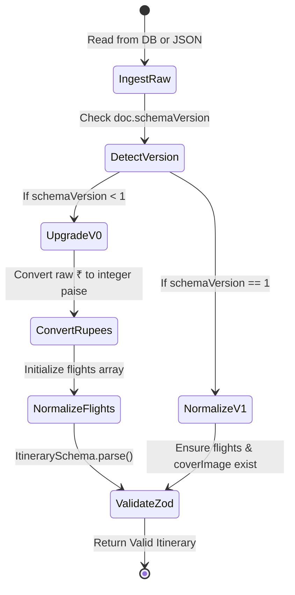
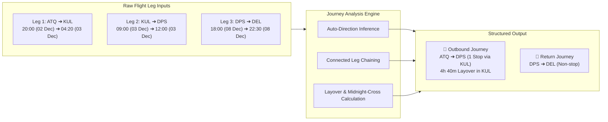

# TrippyGo Architecture & System Design

> **Document:** `ARCHITECTURE.md`  
> **System:** TrippyGo B2B PDF Itinerary Engine  
> **Aesthetic & Technical Standard:** High-Precision Distributed Next.js + Headless Chromium Architecture  
> **Target Audience:** Core Engineering Team, DevOps, Security Auditors  

---

## 1. System Overview & Executive Topology

TrippyGo is a mission-critical B2B proposal and quotation engine engineered for travel agencies. It converts unstructured supplier inputs (raw supplier quotes, WhatsApp chats, unformatted emails, and DMC PDFs) into branded, publication-grade client A4 PDF proposals.

### High-Level Topology Diagram

```mermaid
flowchart TD
    subgraph ClientLayer [Client & User Surfaces]
        UI[Sales / Admin Browser]
        WB[Executive Workbench Dashboard]
        ED[Two-Pane Interactive Editor]
        ST[Agency Policy Settings]
    end

    subgraph AppLayer [Next.js 16 Web Application :3000]
        API_EXT["/api/extract\n(AI Ingestion)"]
        API_ITIN["/api/itineraries\n(CRUD & History)"]
        API_FLIGHT["/api/flights\n(Airport & Schedule)"]
        API_IMG["/api/images\n(Unsplash & Pexels)"]
        PRINT["/print/[id]\n(HMAC-Secured HTML Template)"]
        
        SCH_MIG[Schema Migration & Auto-Healing]
        PRICE_ENG[Pricing & Indian GST Engine]
        VIEW_PROJ["computeClientView()\n(Zero Net Rate Leak)"]
    end

    subgraph AI_Engines [AI Extraction Pipeline]
        GEMINI["Google Gemini API\n(@google/genai)"]
        CLAUDE["Anthropic Claude API\n(@anthropic-ai/sdk)"]
        OPENAI["OpenAI API\n(Fallback LLM)"]
        FALLBACK_P[Offline Heuristic Parser]
    end

    subgraph RenderLayer [Isolated Rendering Engine]
        RP_ROUTER{Render Path Router}
        MICRO[Renderer Microservice :3001\nmcr.microsoft.com/playwright]
        INPROC[In-Process Chromium\nLocal Dev Fallback]
    end

    subgraph DataLayer [Persistence & Storage]
        DB[(PostgreSQL 16 / Neon)]
        LOCAL_JSON[".data/itineraries.json\n(Offline Fallback)"]
        S3[(AWS S3 / MinIO)]
        LOCAL_DISK[".uploads/\n(Offline Fallback)"]
    end

    UI --> WB & ED & ST
    WB --> API_ITIN
    ED --> API_EXT & API_ITIN & API_FLIGHT & API_IMG
    
    API_EXT --> GEMINI & CLAUDE & OPENAI
    GEMINI & CLAUDE & OPENAI -.-> FALLBACK_P
    
    API_ITIN --> SCH_MIG --> DB
    DB -.-> LOCAL_JSON
    
    API_ITIN --> RP_ROUTER
    RP_ROUTER -->|RENDERER_SERVICE_URL set| MICRO
    RP_ROUTER -->|Unset (Local Dev)| INPROC
    
    MICRO & INPROC -->|HMAC Token Request| PRINT
    PRINT --> VIEW_PROJ --> PRICE_ENG
    
    MICRO & INPROC -->|Store PDF Buffer| S3
    S3 -.-> LOCAL_DISK
```

---

## 2. Core Subsystems

### 2.1 AI Ingestion & Multi-LLM Extraction Pipeline

Raw supplier quotes vary wildly across DMCs and tour operators:
- Formal multi-page PDF tables with flight schedules and room categories.
- Informal WhatsApp itineraries with emojis, abbreviations, and Indian rupee notes.
- Email threads with pasted supplier rates, net markup formulas, and terms.

#### Multi-Model Fallback Cascade
The ingestion service (`src/lib/extraction/client.ts`) implements an intelligent provider hierarchy:
1. **Primary Provider:** Google Gemini (`gemini-2.5-flash` / `gemini-2.5-pro` via `@google/genai`) for sub-second, cost-effective structured parsing.
2. **Alternative Tier:** Anthropic Claude (`claude-3-7-sonnet-20250219` via `@anthropic-ai/sdk`) for complex, dense PDF DMC documents.
3. **Backup Tier:** OpenAI (`gpt-4o-mini` / `gpt-4o`) via `@ai-sdk/openai`.
4. **Offline Resilience:** If no API keys are present or external APIs are unreachable, the engine falls back to an offline regex-based heuristic extractor (`extractHeuristicItinerary()`), allowing offline development.

#### Parsing & Token Safeguards
- **Buffer Stream Decoding:** Uploaded PDFs are parsed via `pdf-parse` into clean plaintext streams.
- **Magic Byte Validation:** All uploaded files are inspected for `%PDF-` magic bytes and strictly limited to 10 MB.
- **Strict Structured JSON Prompting:** Extraction prompts require strict adherence to the Zod schema (`ItinerarySchema`), converting loose text dates into `YYYY-MM-DD` and currency strings into integer paise.

---

### 2.2 Schema Migration & Self-Healing Data Layer

All itinerary documents are strictly typed with Zod (`src/lib/schema/itinerary.ts`). To prevent schema rot and breaking changes across software updates:



- **Idempotent In-Flight Migration (`migrateItinerarySchema`):** Every read from the database or local file store passes through migration. Unversioned legacy documents (`schemaVersion: 0`) with floating-point rupees and scalar markup percentages are upgraded to integer paise and structured markup objects on the fly.
- **Safe Fallbacks for Incomplete Drafts:** In the dashboard list view (`toSummary()`), strict schema failures are caught gracefully, preventing a single malformed draft from breaking the operational workbench.

---

### 2.3 Commercials & Margin Governance Engine

The pricing engine (`src/lib/pricing.ts`) enforces strict financial integrity and legal compliance under Indian tax law.

```
┌────────────────────────────────────────────────────────────────────────┐
│                        PRICING COMPUTATION MODEL                       │
├──────────────────────┬─────────────────────────────────────────────────┤
│ Base Unit            │ Integer Paise (1 INR = 100 Paise)               │
│ Arithmetic Rule      │ Zero floating-point drift (Math.round on paise) │
│ Markup Application   │ Net Cost + Markup = Raw Selling Price           │
│ Rounding Slabs       │ nearest_rupee | nearest_50 | nearest_100       │
│ GST Calculation      │ Inclusive (5% tour operator) | Extra | Hidden    │
│ Statutory Compliance │ SAC 998552 • TCS Section 206C Separate Notice   │
└──────────────────────┴─────────────────────────────────────────────────┘
```

#### Core Commercial Invariants:
1. **Integer Paise Storage:** All internal calculations occur in integer paise. ₹1,42,000 is stored as `14200000`. Currency strings (`₹1,42,000`) are computed strictly at display time.
2. **Client View Projection (Zero Net Rate Leak):**
   `computeClientView()` acts as a security firewall. It strips `netAmountPaise`, `markup`, internal supplier DMC contacts, and `meta.sourceFile` before the itinerary payload is sent to client viewports or the PDF renderer.
3. **Automated Leak Verification:** The test harness (`scripts/test-pricing-leak.ts`) generates actual PDF binaries and executes full-text binary regex scans to guarantee zero supplier net figures or formulas ever appear in printed proposals.
4. **Safety Margin Floor:** If sales reps lower the markup below the agency safety floor (e.g. 8%), the interface raises warnings without breaking workflow.

---

### 2.4 Journey-First Flight & Transit Engine

The flight subsystem (`src/lib/flights/journey.ts`) moves beyond fragmented flight leg lists into a coherent human journey model:



#### Key Capabilities:
- **Automatic Midnight-Crossing Detection:** When a flight arrives at an hour numerically earlier than its departure (`04:20 < 20:00`), the engine automatically advances the arrival date by +1 calendar day, ensuring layovers connecting to next-morning flights compute exact elapsed time without 24-hour offsets.
- **Auto-Direction Inference:** Analyzes origin hubs, destination lists, and leg sequences to automatically classify sectors as **Outbound**, **Inbound (Return)**, or **Internal**.
- **Airport Metadata Resolver:** Local cache of 60+ global travel hubs (`src/lib/flights/airports.ts`) auto-populates IATA codes, official city names, and airport titles from partial keystrokes.
- **Boarding Pass PDF Styling:** Rendered as authentic airline boarding pass tickets with perforated stub layouts and baggage tags (`src/templates/itinerary/FlightCard.tsx`).

---

### 2.5 Dual-Path PDF Rendering Engine

PDF rendering is resource-intensive and prone to memory leaks if mismanaged. TrippyGo isolates this workload through a dual-path architecture:

```
┌────────────────────────────────────────────────────────────────────────┐
│                        RENDER PATH ARBITRATION                         │
├────────────────────────────────────────────────────────────────────────┤
│ Is RENDERER_SERVICE_URL configured?                                    │
│                                                                        │
│   ├── YES (Production / Docker Cluster):                              │
│   │   Delegates via HTTP POST to Playwright Microservice (:3001)       │
│   │   - Isolated container (mcr.microsoft.com/playwright)              │
│   │   - Singleton browser instance with concurrency throttling (max 3) │
│   │   - 2 GB shared memory (/dev/shm) allocation                       │
│   │   - Complete process fault isolation: a renderer crash cannot      │
│   │     destabilize the Next.js web process                            │
│   │                                                                    │
│   └── NO (Local Developer Workflow):                                   │
│       Spawns lightweight in-process Playwright Chromium instance.      │
│       Zero-configuration local setup without Docker requirements.      │
└────────────────────────────────────────────────────────────────────────┘
```

#### HMAC Authentication for Headless Rendering
Headless Chromium instances cannot reuse user session cookies. To render the print template securely:
1. The web server creates an HMAC SHA-256 token using `INTERNAL_RENDER_SECRET`, the itinerary ID, and a 60-second expiration timestamp.
2. The renderer navigates to `/print/[id]?token=[hmac]&expires=[timestamp]`.
3. The print route verifies the HMAC signature and timestamp before serving the editorial HTML template.

#### A4 Geometry & Typography Control
- Exact A4 Portrait dimensions (`210mm x 297mm`).
- Chromium print flags: `preferCSSPageSize: true`, `printBackground: true`, `margin: { top: 0, right: 0, bottom: 0, left: 0 }`.
- Zero page orphans: `break-inside: avoid` on day cards, flight passes, and pricing tables; `break-after: avoid` on headers.
- Completely self-hosted web fonts (`Cormorant Garamond`, `Plus Jakarta Sans`, `Caveat`) in `public/fonts/` ensuring offline, deterministic text layout.

---

### 2.6 Persistence & Storage Abstraction

```
+-------------------------------------------------------------------------+
|                  PERSISTENCE & STORAGE FALLBACK MATRIX                  |
+-------------------+-----------------------------+-----------------------+
| Subsystem         | Primary Target              | Transparent Fallback  |
+-------------------+-----------------------------+-----------------------+
| Relational DB     | PostgreSQL 16 (Neon / VPS)  | .data/itineraries.json|
| Binary Documents  | AWS S3 Object Storage       | .uploads/ local disk  |
| Version History   | itinerary_versions table    | JSON version array    |
+-------------------+-----------------------------+-----------------------+
```

- **Seamless Local Fallback:** If PostgreSQL or AWS credentials are not configured, the app automatically switches to local disk persistence without throwing fatal errors.
- **Immutable Version Snapshots:** Every time a client PDF proposal is generated, a new version snapshot is recorded with its corresponding S3 key and content hash, allowing historical auditability and instant rollback.

---

## 3. Security & Threat Mitigation

| Threat Vector | Mitigation Strategy | Implementation |
| :--- | :--- | :--- |
| **SSRF / Cloud Metadata Theft** | Private subnet and metadata egress firewall | `src/lib/security/ssrf.ts`: Blocks RFC 1918 addresses, `169.254.169.254`, and AWS link-local IPs. |
| **Commercial Net Rate Leakage** | Structural projection before client transmission | `computeClientView()` strips net figures and formulas before any data enters the DOM or PDF. Verified in CI. |
| **Unauthenticated PDF Rendering** | Cryptographic HMAC render tokens | Time-limited HMAC-SHA256 signature required on `/print/[id]`. |
| **Malicious File Uploads** | MIME validation + Magic Byte header checks | Strictly validates `%PDF-` magic bytes, rejecting renamed executables and limiting uploads to 10 MB. |
| **Rate Exhaustion / DoS** | In-memory token-bucket rate limiters | Quotas enforced per IP: 10 extractions/hr, 20 PDF renders/hr, 100 image searches/hr. |
| **Credential Leakage** | Client bundle audits in CI | `tests/security/api-keys.test.ts` scans all client components and ensures zero private API keys exist in client bundles. |

---

## 4. Operational Telemetry & Health Checks

- **Web Health:** `GET /health` and `GET /api/health` return HTTP 200 with service uptime, memory metrics, and database connectivity status.
- **Renderer Health:** `GET http://renderer:3001/health` verifies browser process availability and memory usage.
- **Docker Compose Healthchecks:** Configured across all container services with automated restart policies.
