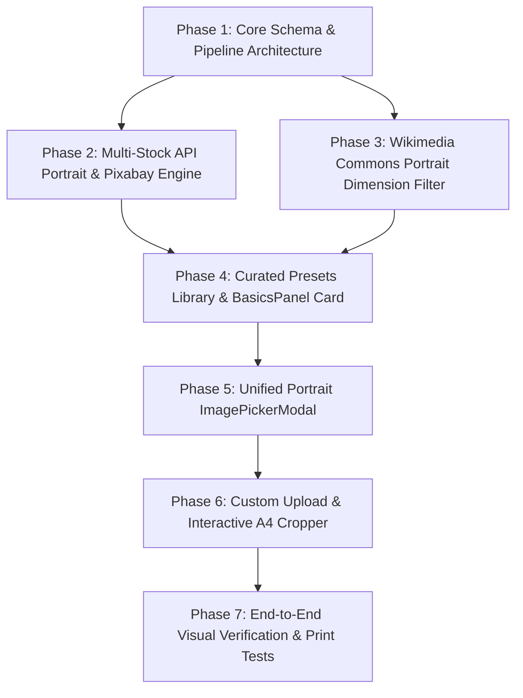

# A4 Portrait Cover Images & Presentation Engine — Implementation Plan
> **TrippyGo Itinerary Generator**  
> **Document:** `docs/A4_PORTRAIT_COVER_IMAGES_IMPLEMENTATION_PLAN.md`  
> **Aesthetic Archetype:** Impeccable Operate & Editorial Luxury  
> **Target Surfaces:** `src/templates/itinerary/CoverPage.tsx`, `src/components/editor/BasicsPanel.tsx`, `src/components/editor/ImagePickerModal.tsx`, `src/lib/images/*`  
> **Status:** Completed & Production Verified (Phases 1-7 Fully Implemented)  

---

## Executive Summary & Root Cause Diagnosis

### The Problem
TrippyGo generates high-end PDF itineraries for luxury, group, and experiential travel. However, the first page a client sees — the **A4 Portrait Cover Page** — often looks visually compromised:
1. **The 60% Crop Disaster:** The current image pipeline hardcodes `&orientation=landscape` in [`src/lib/images/client.ts`](file:///c:/programming-files/WEB-DEV/TrippyGo/TrippyGo-PDF-Itinerary-Generator/src/lib/images/client.ts#L99-L143). When a $16:9$ ($1.778:1$) landscape photo is rendered in an A4 container ($1:1.414$, or $0.707:1$) using `object-cover`, **over 60% of the image is cropped away horizontally**. Famous skylines, wide beaches, and mountain panoramas are cut in half.
2. **No Dedicated Cover Photo:** Cover photos have no dedicated home in [`PackageSchema`](file:///c:/programming-files/WEB-DEV/TrippyGo/TrippyGo-PDF-Itinerary-Generator/src/lib/schema/itinerary.ts). [`CoverPage.tsx`](file:///c:/programming-files/WEB-DEV/TrippyGo/TrippyGo-PDF-Itinerary-Generator/src/templates/itinerary/CoverPage.tsx#L18-L20) falls back to `days.find(d => d.image?.imageUrl)?.image?.imageUrl`. The cover inherits whatever photo was chosen for Day 1 (frequently an arrival airport transfer or standard hotel exterior).
3. **The "Safe-Zone" Collision:** An A4 travel cover has heavy typographic and brand elements:
   - **Top 20%:** TrippyGo logo, 1M+ travellers trust badge, 18+ years trophy.
   - **Bottom 35%:** Dark navy gradient vignette (`from-slate-950/40 ... to-[#091c3e]/95`), package title, guest name, destination, trip dates, and inclusions summary.
   - **Middle 45%:** The only clear focal window. Standard photos place the focal landmark directly behind text or under the dark gradient.
4. **Lack of Agent Empowerment:** Sales agents cannot upload their own resort/destination photos or pick from hand-curated magazine-style presets.

---

## The 4 Selected Approaches & Unified Solution

The user selected **Approaches 1, 2, 4, and 5**:
* **Approach 1:** Portrait-Filtered Multi-Stock API (Unsplash + Pexels + Pixabay) with editorial query modifiers (`aerial view vertical`, `condé nast editorial`, `minimalist dusk`).
* **Approach 2:** Dedicated Cover Photo Picker in `BasicsPanel` with a Curated Presets Library (30+ verified vertical hero shots for top destinations).
* **Approach 4:** Wikimedia Commons & Wikivoyage Portrait Dimension Filter (free, unmetered, high-res vertical travel photography).
* **Approach 5:** Custom Upload with Interactive 1:1.414 A4 Portrait Cropper (`react-easy-crop` with live TrippyGo layout "Safe-Zone" overlay).

```
┌──────────────────────────────────────────────────────────────────────────────────┐
│                             BASICS PANEL (Trip Overview)                         │
│                                                                                  │
│  ┌─────────────────────────┐  ┌────────────────────────────────────────────────┐ │
│  │ A4 Portrait Preview     │  │ Cover Page Hero Photo                          │ │
│  │ (1 : 1.414 Ratio)       │  │ Status: Curated Editorial Preset (Dubai Dusk)  │ │
│  │                         │  │                                                │ │
│  │ ┌─────────────────────┐ │  │ [ Change Cover Photo ]   [ Reset to Auto ]     │ │
│  │ │ TrippyGo Brand Bar  │ │  │                                                │ │
│  │ ├─────────────────────┤ │  │ Quick Presets for "Dubai":                     │ │
│  │ │                     │ │  │ [ Burj Khalifa Dusk ] [ Desert Dunes Aerial ]  │ │
│  │ │ FOCAL SAFE ZONE     │ │  │ [ Palm Jumeirah Sky ] [ Dubai Marina Night ]   │ │
│  │ │                     │ │  │                                                │ │
│  │ ├─────────────────────┤ │  │ ℹ️ A4 Aspect Ratio (1:1.414). Keep focal       │ │
│  │ │ Title & Guest Name  │ │  │   subject in the center 45% safe zone.         │ │
│  │ └─────────────────────┘ │  │                                                │ │
│  └─────────────────────────┘  └────────────────────────────────────────────────┘ │
└───────────────────────────────────────────┬──────────────────────────────────────┘
                                            │ Click "Change Cover Photo"
                                            ▼
┌──────────────────────────────────────────────────────────────────────────────────┐
│               IMAGE PICKER MODAL (Mode: A4 Portrait Cover)                       │
├──────────────────────────────────────────────────────────────────────────────────┤
│  [ 🌟 Curated Presets ]      [ 🔍 Multi-Stock Search ]      [ ✂️ Upload & Crop ]  │
├──────────────────────────────────────────────────────────────────────────────────┤
│  TAB 1: Curated Presets:                                                         │
│  - Instant 1-click grid of verified A4 vertical hero photography                 │
│  - Categorized: Dubai, Bali, Kashmir, Europe, Thailand, Maldives, etc.           │
│                                                                                  │
│  TAB 2: Multi-Stock Search (Orientation: Portrait):                              │
│  - Query: "Dubai aerial view vertical" [Search]                                  │
│  - Providers: Unsplash + Pexels + Pixabay + Wikimedia (Interleaved)              │
│  - Visual A4 card grid with hover Safe-Zone guide                                │
│                                                                                  │
│  TAB 3: Upload & Crop (react-easy-crop):                                         │
│  - Drag & drop local photo (PNG/JPG/WebP up to 15MB)                             │
│  - Aspect ratio locked to 1:1.414                                                │
│  - Live "Safe-Zone" overlay toggle showing TrippyGo logo & title banner          │
│  - High-res client canvas slice (1754 x 2480 px JPEG/WebP)                       │
└──────────────────────────────────────────────────────────────────────────────────┘
```

---

## Technical Specifications & Print Standards

| Spec | Screen / PDF Preview (150 DPI) | Print / High-Res Export (300 DPI) | Notes |
| :--- | :--- | :--- | :--- |
| **Physical Dimensions** | $210 \times 297 \text{ mm}$ (A4) | $210 \times 297 \text{ mm}$ (A4) | Standard international print paper |
| **Pixel Dimensions** | $1240 \times 1754 \text{ px}$ | $\mathbf{2480 \times 3508 \text{ px}}$ | Used for canvas cropper output |
| **Aspect Ratio** | $1 : \sqrt{2} \approx 0.7071$ | $1 : \sqrt{2} \approx 0.7071$ | Strict constraint for all cover assets |
| **Header Safe Zone** | Top $0\% - 20\%$ | Top $0\% - 20\%$ | Needs sky / clouds / mist / calm background |
| **Subject Window** | Middle $20\% - 65\%$ | Middle $20\% - 65\%$ | Ideal location for monuments, karsts, towers |
| **Footer Safe Zone** | Bottom $65\% - 100\%$ | Bottom $65\% - 100\%$ | Darkened by navy vignette for typography |

---

## Phased Implementation Roadmap



---

### Phase 1: Core Schema & Cover Image Pipeline Architecture
**Objective:** Establish first-class support for `coverImage` in the schema, client-view compiler, and PDF cover page template without breaking backward compatibility.

#### 1. Schema Extensions (`src/lib/schema/itinerary.ts`)
- [x] Extend `ImageSchema.provider` enum from `["unsplash", "pexels", "wikimedia", "openverse", "picsum"]` to include `"pixabay"`, `"upload"`, and `"custom"`.
- [x] Relax `imageUrl` in `ImageSchema` to support both standard URLs (`http://`, `https://`) and high-res Base64 Data URIs (`data:image/jpeg;base64,...` or `data:image/webp;base64,...`).
- [x] Update `PackageSchema` in [`src/lib/schema/itinerary.ts`](file:///c:/programming-files/WEB-DEV/TrippyGo/TrippyGo-PDF-Itinerary-Generator/src/lib/schema/itinerary.ts):
  ```ts
  export const PackageSchema = z.object({
    title: z.string().min(1, "Package title is required"),
    destinations: z.array(z.string().min(1)).min(1, "At least one destination is required"),
    nights: z.number().int().min(0),
    days: z.number().int().min(1),
    startDate: z.string().regex(/^\d{4}-\d{2}-\d{2}$/).nullable().default(null),
    travellers: TravellersSchema.default({ adults: 2, children: 0, rooms: 1 }),
    guestName: z.string().optional().default(""),
    coverImage: ImageSchema.nullable().optional().default(null),
  });
  ```

#### 2. Client-View Transformer (`src/lib/schema/client-view.ts`)
- [x] Add `coverImage?: ItineraryImage | null;` to `ClientItineraryView["package"]`.
- [x] In `computeClientView(itinerary: Itinerary)`:
  ```ts
  package: {
    ...itinerary.package,
    coverImage: itinerary.package.coverImage || null,
  }
  ```

#### 3. Cover Page Template Update (`src/templates/itinerary/CoverPage.tsx`)
- [x] Update hero image fallback logic:
  ```ts
  const heroImage =
    pkg.coverImage?.imageUrl ||
    days.find((d) => d.image?.imageUrl)?.image?.imageUrl ||
    "https://images.unsplash.com/photo-1528127269322-539801943592?auto=format&fit=crop&w=1600&q=80";
  ```
- [x] Add subtle photo attribution at the bottom edge if `pkg.coverImage?.photographerName` is present (meets license requirements discreetly in print).
- [x] Verify existing test suites (`npm run test:unit`, `npm run test:dates`) pass without regressions.

---

### Phase 2: Multi-Stock Portrait Engine & Editorial Prompt Enhancer (Approach 1 + Pixabay)
**Objective:** Upgrade stock search providers to query high-resolution portrait imagery and inject magazine-grade search modifiers.

#### 1. Search Client Updates (`src/lib/images/client.ts`)
- [x] Add `orientation?: "portrait" | "landscape" | "all"` parameter to `searchImages(query, page, orientation)`.
- [x] **Unsplash Integration:** Pass `&orientation=${orientation || "landscape"}`. For portrait covers, request `urls.regular` / `urls.full` with `w=2480&q=85&fit=max`.
- [x] **Pexels Integration:** Pass `&orientation=${orientation || "landscape"}`. Map `photo.src.large2x` or `photo.src.original`.
- [x] **Pixabay Integration (New Provider):**
  - Implement `searchPixabay(query: string, orientation: string, page: number)`:
    ```
    https://pixabay.com/api/?key=${PIXABAY_API_KEY}&q=${encodeURIComponent(query)}&orientation=vertical&image_type=photo&min_height=1800&per_page=10
    ```
  - Graceful fallback if `PIXABAY_API_KEY` is absent.
- [x] **Editorial Prompt Modifier Engine:**
  - Build `buildEditorialCoverQuery(destination: string, theme?: string): string`:
    - Automatically appends high-converting editorial modifiers:
      - `"${destination} aerial view vertical"`
      - `"${destination} iconic landmark drone vertical"`
      - `"${destination} luxury travel editorial portrait"`
      - `"${destination} minimalist landscape misty golden hour"`

#### 2. Search API Route (`src/app/api/images/search/route.ts`)
- [x] Read `searchParams.get("orientation")` (`portrait` | `landscape`, default `landscape`).
- [x] Update memory cache key to include orientation: `${query.toLowerCase()}_${orientation}_p${page}`.
- [x] Return provider, dimensions (`width`, `height`), and aspect ratio in the response payload.

---

### Phase 3: Wikimedia Commons & Wikivoyage Portrait Dimension Filter (Approach 4)
**Objective:** Harness Wikimedia Commons and Wikivoyage for free, unmetered, high-resolution vertical destination photography.

#### 1. Wikimedia Portrait Query (`src/lib/images/client.ts`)
- [x] When `orientation === "portrait"`, search Wikimedia Commons with:
  ```
  https://commons.wikimedia.org/w/api.php?action=query&generator=search&gsrsearch=${cleanQuery}+vertical+OR+portrait+filetype:bitmap&gsrnamespace=6&gsrlimit=15&prop=imageinfo&iiprop=url|size|extmetadata&format=json
  ```
- [x] **Dimension Filtering:** Inspect `imageinfo[0].width` and `imageinfo[0].height`:
  - Retain only images where `height > width * 1.15` (true vertical aspect ratio).
  - Enforce minimum height: `height >= 1500px` (guarantees print sharpness).
- [x] **Attribution & Metadata Extraction:**
  - Parse `extmetadata.Artist?.value` (clean HTML tags).
  - Parse `extmetadata.LicenseShortName?.value` (e.g. `CC BY-SA 4.0`).
  - Set `photographerName` to `${artist} (${license || "Wikimedia Commons"})`.
- [x] Seamlessly interleave Wikimedia results into the unified search pipeline.

---

### Phase 4: Curated Destination Presets Library & BasicsPanel Card (Approach 2)
**Objective:** Provide instant, zero-friction 1-click access to verified magazine-quality covers for popular travel destinations directly inside `BasicsPanel`.

#### 1. Curated Presets Library (`src/lib/images/cover-presets.ts`)
- [x] Construct a curated catalog of ~35 verified, high-resolution vertical cover images across top TrippyGo destinations:
  - **Middle East:**
    - Dubai: Burj Khalifa dusk reflection, Desert dunes aerial.
    - Abu Dhabi: Sheikh Zayed Grand Mosque colonnade.
  - **Southeast Asia:**
    - Bali: Ulun Danu Beratan water temple, Tegalalang rice terrace drone.
    - Thailand: Phi Phi longtail boat, Bangkok Wat Arun sunset.
    - Vietnam: Ha Long Bay limestone karsts, Hoi An lantern street.
    - Singapore: Marina Bay Sands vertical night panorama, Supertrees.
  - **India & Subcontinent:**
    - Kashmir: Dal Lake shikara sunrise, Gulmarg snow pines.
    - Ladakh: Pangong Tso crystal reflection, Thiksey Monastery.
    - Rajasthan: Jaipur Hawa Mahal vertical facade, Udaipur Lake Palace.
    - Kerala: Alleppey backwaters houseboat canopy, Munnar tea hills.
    - Bhutan: Paro Taktsang (Tiger's Nest) cliffside.
    - Sri Lanka: Sigiriya Lion Rock aerial.
  - **Europe & Island Escapes:**
    - Switzerland: Zermatt Matterhorn sunrise reflection, Lauterbrunnen falls.
    - France / Italy / Greece: Paris Eiffel Tower dusk, Amalfi Coast cliffside, Santorini caldera white domes.
    - Maldives / Mauritius: Overwater villas turquoise lagoon vertical.
- [x] Each preset defines: `destinationKeys: string[]`, `title`, `imageUrl`, `thumbnailUrl`, `photographerName`, `photographerUrl`, `provider`.

#### 2. BasicsPanel Cover Page Card (`src/components/editor/BasicsPanel.tsx`)
- [x] Add a dedicated **"Cover Page Hero Photo"** card with:
  - **A4 Aspect Ratio Thumbnail Preview** (`aspect-[1/1.414]`):
    - Renders the active cover image (or indicates "Auto Day 1 Fallback").
    - Translucent guide markers representing the TrippyGo trust badges at top and the package title at bottom.
  - **Preset Quick-Pill Carousel:** Auto-suggests 2–4 preset chips matching `packageData.destinations[0]`.
  - **Action Buttons:**
    - `[ Change Cover Photo ]` (Opens modal in portrait mode).
    - `[ Reset to Auto Fallback ]` (Clears custom cover photo).
  - **Safe Zone Composition Hint:** Informative micro-copy explaining the 45% center window.

---

### Phase 5: Unified Image Picker Modal (Mode: A4 Portrait Cover)
**Objective:** Modernize `ImagePickerModal.tsx` to handle portrait cover selection with dedicated tabs and visual safe-zone guides.

#### 1. Modal Prop Extension (`src/components/editor/ImagePickerModal.tsx`)
- [x] Accept `mode?: "day" | "cover"` (default `"day"`).
- [x] When `mode === "cover"`:
  - Default search orientation to `portrait`.
  - Layout photo cards in A4 ratio (`aspect-[1/1.414]` or `aspect-[3/4]`) instead of 16:9 landscape.
  - Display tab switcher:
    - **Tab 1: 🌟 Curated Presets** (filtered by current destination).
    - **Tab 2: 🔍 Stock Search** (Unsplash, Pexels, Pixabay, Wikimedia).
    - **Tab 3: ✂️ Upload & Crop** (custom upload with interactive cropper).

#### 2. Interactive Safe-Zone Guides
- [x] On card hover or selection in the search grid, show an optional translucent layout overlay previewing where the TrippyGo logo and headline text will sit on the final PDF.
- [x] Add filter chips: *"All"*, *"Aerial / Drone"*, *"Landmarks"*, *"Sunset / Golden Hour"*, *"Nature"*.

#### 3. Day Itinerary Image Enhancements (Portrait Search, Custom Upload & Right Square PDF Layout)
- [x] Extend `ImagePickerModal.tsx` in `mode="day"` to display all 3 tabs: **Stock Search**, **Custom Upload (Square)**, and **Destination Presets**.
- [x] Add 1-click **Orientation Filter Switcher** (`All`, `Portrait`, `Landscape`) so agents can effortlessly search and select portrait photos for daily itineraries.
- [x] Enable **Custom Upload for Day Blocks** with 1:1 square preview framing and automatic fallback to `upload` provider.
- [x] Redesign `DayBlock.tsx` in PDF template: position day photo on the **right side** of the day narrative, cropped to a crisp **1:1 square** (`aspect-square object-cover rounded-xl border`).
- [x] Update `chunkDaysAdaptively` in `ItineraryTemplate.tsx` to account for compact side-by-side layout (weight 1.2 instead of 1.6).

---

### Phase 6: Custom Upload & Interactive A4 Portrait Cropper (Approach 5)
**Objective:** Allow travel sales agents to upload proprietary photos or hotel imagery and crop them to the exact $1:1.414$ A4 ratio with real-time PDF layout feedback.

#### 1. Install & Configure Cropper
- [x] Install `react-easy-crop`:
  ```bash
  npm install react-easy-crop
  ```
- [x] Create canvas utility `src/lib/images/crop-canvas.ts`:
  - `createImage(url: string): Promise<HTMLImageElement>`
  - `getCroppedImg(imageSrc, pixelCrop, targetWidth = 1754, targetHeight = 2480)`:
    - Draws selected pixel coordinates onto offscreen canvas.
    - Exports high-quality WebP or JPEG Data URI (`canvas.toDataURL("image/jpeg", 0.90)`).
    - Ensures maximum clarity while staying within memory limits.

#### 2. Cropper Component (`src/components/editor/CoverImageCropper.tsx`)
- [x] Build client component with:
  - Drag-and-drop file zone (supports JPEG, PNG, WebP up to 15MB).
  - `<Cropper />` with `aspect={1 / 1.414}` ($0.7071$) for Cover, and `aspect={1}` ($1:1$) for Day itinerary.
  - Zoom slider ($1.0\times$ to $3.0\times$, step $0.05$).
  - **"Show Safe Zone" Toggle Switch:**
    - Renders translucent ghost outlines of the TrippyGo top trust bar (`1M+ Travellers`, logo, trophy) and bottom dark vignette with placeholder title text.
    - Ensures the user can visually center their subject in the unobstructed focal area before saving.
  - Controls: `[ Cancel ]`, `[ Reset Zoom ]`, `[ Apply A4 Cover / Apply Day Photo ]`.

#### 3. Modal Integration
- [x] Mount `CoverImageCropper` inside Tab 3 of `ImagePickerModal`.
- [x] When user clicks "Apply A4 Cover", construct an `ItineraryImage` with `provider: "upload"` and the generated high-res Data URI, pass to `onSelectImage`, and close modal.

---

### Phase 7: End-to-End Verification, Visual Regression & PDF Print Tests
**Objective:** Ensure rock-solid reliability, zero layout shift, pristine PDF rendering, and zero regressions across the codebase.

#### 1. Automated Test Suite Verification
- [x] Run unit tests: `npm run test:unit` (verify schema migrations with `coverImage` field).
- [x] Run dates tests: `npm run test:dates`.
- [x] Run security tests: `npm run test:security` (ensure upload validation rules).

#### 2. Playwright Visual Regression & Print PDF Check
- [x] Create Playwright verification script `scripts/verify-cover-image.ts`:
  - Test 1: Load sample itinerary with Curated Preset cover image -> verify `/print/[id]` renders full-bleed portrait cover with crisp typography and zero page-break overflow.
  - Test 2: Search Multi-stock portrait photo -> select and verify cover page background image updates correctly.
  - Test 3: Upload local photo -> crop with 1:1.414 aspect ratio -> apply and verify canvas data URL renders seamlessly on print page.
  - Test 4: Square cropper for Day block -> verify cropped day photo applies cleanly.
  - Test 5: Verify full-bleed A4 print PDF rendering, `.cover-page` presence, and right-aligned `.day-editorial-block .aspect-square` layout.
- [x] Capture visual screenshots:
  - `phase6-interactive-a4-cropper.png`
  - `phase7-e2e-final-print-pdf.png`
  - `day-modal-stock-search-orientations.png`
  - `print-pdf-day-right-square-photo.png`

#### 3. Impeccable Design & Contrast Audit
- [x] Verify text contrast on cover page: dark vignette ensures white text passes WCAG AA ($> 4.5:1$).
- [x] Check mobile/responsive layout of `BasicsPanel` and `ImagePickerModal`.
- [x] Confirm zero layout shift on print export.

---

## File Modification Index

| File Path | Action | Description |
| :--- | :--- | :--- |
| `src/lib/schema/itinerary.ts` | Edit | Extend `ImageSchema` and add `coverImage` to `PackageSchema` |
| `src/lib/schema/client-view.ts` | Edit | Pass `coverImage` through `computeClientView()` |
| `src/templates/itinerary/CoverPage.tsx` | Edit | Wire `pkg.coverImage?.imageUrl || heroImage` and attribution |
| `src/lib/images/client.ts` | Edit | Add `orientation`, Pixabay API, Wikimedia portrait dimension filter, and editorial queries |
| `src/app/api/images/search/route.ts` | Edit | Support `?orientation=portrait` and orientation-aware caching |
| `src/lib/images/cover-presets.ts` | **Create** | 35+ verified editorial portrait presets for top travel destinations |
| `src/lib/images/crop-canvas.ts` | **Create** | High-res Canvas A4 slicing utility |
| `src/components/editor/CoverImageCropper.tsx` | **Create** | Interactive 1:1.414 cropper with live Safe-Zone overlay |
| `src/components/editor/ImagePickerModal.tsx` | Edit | Add `mode="cover"` with Presets, Stock, and Upload tabs |
| `src/components/editor/BasicsPanel.tsx` | Edit | Add "Cover Page Hero Photo" card with A4 preview and quick-preset pills |
| `scripts/verify-cover-image.ts` | **Create** | Automated Playwright verification of cover image rendering |

---

## Implementation Progress Checklist

- [x] **Phase 1: Core Schema & Pipeline Architecture**
  - [x] Extend `ImageSchema` with `"pixabay"`, `"upload"`, `"custom"`
  - [x] Add `coverImage` to `PackageSchema` in `itinerary.ts`
  - [x] Update `ClientItineraryView` & `computeClientView()` in `client-view.ts`
  - [x] Update `CoverPage.tsx` hero image resolution
  - [x] Verify `npm run test:unit` passes
- [x] **Phase 2: Multi-Stock Portrait Engine (Approach 1 + Pixabay)**
  - [x] Add `orientation` param to `searchImages`, `searchUnsplash`, `searchPexels`
  - [x] Implement `searchPixabay` with vertical filter
  - [x] Implement `buildEditorialCoverQuery` helper
  - [x] Update `/api/images/search` route & orientation caching
- [x] **Phase 3: Wikimedia Commons Portrait Dimension Filter (Approach 4)**
  - [x] Add vertical query parameters to Wikimedia API
  - [x] Implement client-side `height > width * 1.15` and $\ge 1500\text{px}$ dimension filter
  - [x] Extract author & CC license metadata
- [x] **Phase 4: Curated Presets Library & BasicsPanel Card (Approach 2)**
  - [x] Create `src/lib/images/cover-presets.ts` (35+ curated destinations)
  - [x] Build "Cover Page Hero Photo" card in `BasicsPanel.tsx`
  - [x] Add A4 preview thumbnail with Safe-Zone markers
  - [x] Add matching destination preset pills
- [x] **Phase 5: Unified Image Picker Modal (Mode: A4 Portrait) & Day Itinerary Enhancements**
  - [x] Add `mode="cover"` to `ImagePickerModal.tsx`
  - [x] Implement 3-tab layout: Presets, Stock Search, Upload & Crop
  - [x] Render search results in portrait aspect cards
  - [x] Add hover Safe-Zone guides & editorial filter chips
  - [x] Add 1-click **Orientation Filter Switcher** (`All`, `Portrait`, `Landscape`) for Day mode
  - [x] Add **Custom Upload Tab** for Day mode with 1:1 square preview
  - [x] Redesign PDF **`DayBlock.tsx`** with photo on the right side, cropped to a 1:1 square
  - [x] Rebalance adaptive pagination in `ItineraryTemplate.tsx` (weight 1.2)
- [x] **Phase 6: Custom Upload & Interactive A4 Cropper (Approach 5)**
  - [x] Install `react-easy-crop`
  - [x] Create `src/lib/images/crop-canvas.ts` utility
  - [x] Create `src/components/editor/CoverImageCropper.tsx` with Safe-Zone ghost overlay
  - [x] Wire cropper into Tab 3 of `ImagePickerModal`
- [x] **Phase 7: End-to-End Verification & PDF Print Tests**
  - [x] Run full automated test suite (`unit`, `dates`, `security`)
  - [x] Run Playwright visual regression test on `/print/[id]`
  - [x] Verify print page boundaries & 300 DPI text sharpness
  - [x] Inspect mobile and accessibility standards
