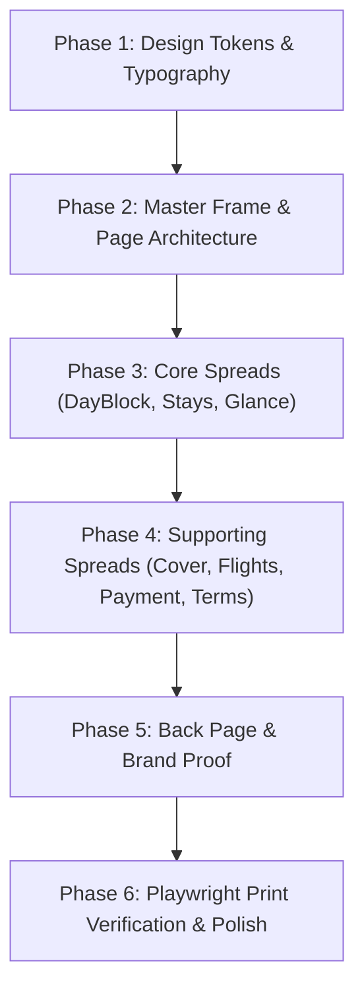

# TrippyGo PDF Itinerary — Systematic Design Redesign Plan

> **Scope:** Exclusively focused on elevating the visual design, typography, layout hierarchy, and print fidelity of the generated A4 PDF itinerary. No modifications to database schemas, AI extraction logic, pricing calculations, or backend APIs.

---

## Executive Summary & Design Vision

The current PDF output suffers from the **"Cardocalypse" and AI-slop anti-patterns**:
- Nested white rounded boxes with drop shadows on every section (SaaS dashboard feel).
- Repetitive outline icons prepended to every single label.
- Overuse of colored pill badges (`rounded-full`).
- Web-default sans-serif fonts lacking editorial authority.
- Competing accent colors (red, blue, yellow, amber, green, slate) without clear hierarchy.

### The Target Aesthetic: "Bespoke Editorial Travel Journal"
We are transforming the PDF from an automated web dump into a **curated, high-end travel publication** reminiscent of *Condé Nast Traveler*, *Kinfolk*, or *Aman Resorts* client portfolios:
1. **Editorial Typography:** High-contrast serif headlines (**Cormorant Garamond**) paired with geometric, print-dense sans-serif body copy (**Plus Jakarta Sans**) and an intimate signature script (**Caveat**).
2. **Whitespace over Boxes:** Elimination of floating cards. Sections breathe naturally on a crisp ivory canvas (`#FAFAF7`) with delicate architectural hairline dividers (`#E2E8F0` / `#091c3e15`).
3. **Restrained Color Discipline (60-30-10):**
   - **60% Dominant:** Warm, luminous ivory/white background.
   - **30% Structural:** Deep architectural navy (`#091c3e`) for primary headings, section dividers, and structural grounding.
   - **10% Accent:** Signature TrippyGo Red (`#c92229`) reserved strictly for focal points (day markers, price highlights, callouts). Champagne gold is isolated to the cover.
4. **Print-Engine Optimization:** Bulletproof `@font-face` static embedding, strict A4 pagination guarantees (`break-inside: avoid`), zero orphaned headers, and subpixel vector rendering in Playwright.

---

## Role of `/impeccable` in this Redesign

Following the research findings, `/impeccable` acts as our **design intelligence layer and quality controller**:
- `impeccable init`: Initializes and locks product truths into `PRODUCT.md`.
- `impeccable document`: Formalizes typographic scales, color tokens, and spatial rhythm into `DESIGN.md`.
- `impeccable typeset`: Enforces strict font hierarchy, line lengths (45–75 characters), and print leading (1.3–1.4 line-height).
- `impeccable bolder`: Injects bold editorial confidence and cuts passive filler copy.
- `impeccable layout`: Replaces card grids with asymmetrical editorial flows.
- `impeccable audit`: Runs automated design heuristics and accessibility checks on the revised components.
- `impeccable polish`: Final micro-craft pass on alignment, padding, and visual balance.

Manual Print CSS provides the physical grounding: `@page` rules, millimeter-perfect dimensions, and Chromium print emulation flags.

---

## Phased Implementation Roadmap

---

## Phase 1: Design Tokens, Typography & Font Assets

**Objective:** Establish the foundational design system in `DESIGN.md`, self-host print-optimized vector fonts, and configure `src/styles/print.css` & `src/app/globals.css`.

### Tasks & Technical Details
1. **Self-Host Typography for Playwright Rendering:**
   - Download static `.ttf` / `.woff2` files for **Cormorant Garamond** (Regular, Medium, SemiBold, Bold, Italic) and **Plus Jakarta Sans** (Regular, Medium, SemiBold, Bold).
   - Store in `public/fonts/`. This prevents Playwright SSRF blocks or network latency from substituting system fallback fonts.
2. **Configure `@font-face` & Utility Classes:**
   - Define explicit `@font-face` blocks with `font-display: swap` in `src/styles/print.css`.
   - Setup font classes:
     - `.font-serif-luxury` -> `'Cormorant Garamond', Georgia, serif`
     - `.font-display` -> `'Plus Jakarta Sans', sans-serif`
     - `.font-body` -> `'Plus Jakarta Sans', sans-serif`
     - `.font-script` -> `'Caveat', cursive`
3. **Token Restructuring (`globals.css` & `print.css`):**
   - Retire unused saturated tints (`--surface-tint-blue`, `--surface-tint-gold`, `--surface-tint-green`).
   - Standardize palette:
     - Canvas: `#FAFAF7` (warm ivory)
     - Midnight Navy: `#091c3e`
     - Heritage Red: `#c92229`
     - Border Hairline: `#e2e8f0` / `#cbd5e1`
     - Muted Text: `#64748b`
4. **Impeccable Context Setup:**
   - Run `impeccable init` to generate/update `PRODUCT.md` tailored to luxury travel itinerary proposals.
   - Run `impeccable document` to create `DESIGN.md`.

### Phase 1 Checklist (Completed)
- [x] `public/fonts/` contains verified `CormorantGaramond-*.ttf` and `PlusJakartaSans-*.ttf` files.
- [x] `@font-face` rules declared in `src/styles/print.css` with local file paths.
- [x] Unused background tints and noisy CSS variables pruned from `src/styles/print.css`.
- [x] Font scale defined (Display Serifs: 32px–48px; Section Titles: 24px–28px; Sub-labels: 9px–11px uppercase tracked; Body: 10px–11px with 1.35 leading).
- [x] `PRODUCT.md` and `DESIGN.md` committed and verified.

---

## Phase 2: Master Frame, Running Headers & Page Architecture

**Objective:** Redesign the document chassis, running headers/footers, and section openers in `src/templates/itinerary/PageHeaderFooter.tsx` and `ItineraryTemplate.tsx`.

### Tasks & Technical Details
1. **Section Title Overhaul (`PageHeaderFooter.tsx`):**
   - Eliminate the centered heading + centered red pill bar anti-pattern.
   - Implement an editorial magazine chapter opener:
     - Left-aligned high-contrast Cormorant Garamond serif heading (`text-2xl md:text-3xl font-serif-luxury text-[#091c3e]`).
     - Subtle chapter tracking label above the title (e.g., `SECTION 02 // JOURNEY SCHEDULE` at `text-[9px] tracking-[0.25em] text-slate-400 uppercase`).
     - Full-width delicate hairline border (`border-b border-slate-200`) grounding the section.
2. **Running Page Footer Redesign (`PageFooter`):**
   - Remove heavy top borders and bright colors.
   - Use a whisper-quiet footer:
     - Left: `TrippyGo` (bold brand serif or clean red geometric sans) + `Bespoke Travel Collection`.
     - Right: Editorial pagination format (`02 / 08` or `Page 02`).
3. **Page Container Calibration (`ItineraryTemplate.tsx`):**
   - Standardize the `itinerary-page` wrapper: exact A4 aspect ratio, consistent `padding: 12mm 14mm` in print.
   - Enforce clean page breaks: `.avoid-break { break-inside: avoid !important; page-break-inside: avoid !important; }`.

### Phase 2 Checklist (Completed)
- [x] Centered red underline bars removed from all section titles.
- [x] Editorial left-aligned section headers with uppercase tracking kicker introduced.
- [x] Running footer converted to clean luxury micro-text (`text-[10px] text-slate-400`).
- [x] Dynamic total page count or clean zero-padded page numbers (`01`, `02`, etc.) implemented.
- [x] Page-break boundaries tested across multi-page sections.

---

## Phase 3: Core Spreads Overhaul (Eliminating the Cardocalypse)

**Objective:** Strip card wrappers and SaaS widget styling from the three primary itinerary content templates: `DayBlock.tsx`, `StaysTable.tsx`, and `TripGlance.tsx`.

### Tasks & Technical Details
1. **`DayBlock.tsx` (Highest Impact Transformation):**
   - **Kill the Card:** Remove `bg-white border border-slate-200 rounded-2xl shadow-sm`. Day blocks now sit directly on the editorial page surface.
   - **Chronological Typography:**
     - Replace the day badge with a bold editorial numeral or kicker: `DAY 01` in Cormorant Garamond serif (`text-3xl text-[#091c3e] font-serif-luxury`) with a vertical or horizontal hairline accent.
     - Destination displayed cleanly as an uppercase tracked caption: `UDAIPUR, RAJASTHAN` in `#c92229`.
   - **Narrative Copywriting Flow:**
     - Body text styled with editorial leading (`text-[10.5pt] leading-[1.4] text-slate-700`).
     - Remove outline icons next to "Stay:" and "Meals:". Replace with a clean metadata strip:
       `ACCOMMODATION: The Oberoi Udaivilas  •  MEAL PLAN: Breakfast Included`.
   - **Cinematic Photography Spread:**
     - Remove the cheesy double-image grid that displayed duplicate thumbnails.
     - Single high-res full-width photo or asymmetric 60/40 text-to-photo split with rounded-lg corners.
     - Replace dark navy "Destination Spotlight" bar with a minimalist bottom-right photo credit (`Photo: Photographer via Unsplash` at `text-[8.5px] text-slate-400 italic`).
2. **`StaysTable.tsx` (Accommodations):**
   - Replace chunky individual cards with an editorial hotel showcase:
     - Either a clean typographic table with subtle alternating rows or horizontal summary strips.
     - Property name in Cormorant Garamond (`text-lg font-serif-luxury font-bold text-[#091c3e]`).
     - Check-in, Check-out, Room Category, and Meal Plan organized in clear tabular columns without redundant calendar icons.
     - Night count badge changed from bright amber bubble to a refined badge (`border border-slate-300 text-slate-800 text-[10px] uppercase tracking-wider`).
3. **`TripGlance.tsx` (Summary Schedule):**
   - Elevate the table header: Midnight Navy background with white Cormorant Garamond titles or crisp uppercase tracking.
   - Days styled with bold tabular numerals.
   - Activity descriptions given comfortable padding and clean typography.

### Phase 3 Checklist (Completed)
- [x] `DayBlock.tsx`: Card borders and drop shadows completely eliminated.
- [x] `DayBlock.tsx`: Duplicate photo grid removed; replaced by single cinematic photo layout.
- [x] `DayBlock.tsx`: Outline icon spam removed from stay/meal tags.
- [x] `StaysTable.tsx`: Heavy cards converted into an elegant hotel catalog or structured table.
- [x] `TripGlance.tsx`: Table styled with editorial typography and refined row spacing.
- [x] Multi-day chunking (2 days per page) verified to ensure zero page overflow.

---

## Phase 4: Supporting Spreads & Logistics

**Objective:** Redesign the Cover Page, Flight Cards, Pricing & Inclusions/Exclusions with luxury editorial discipline.

### Tasks & Technical Details
1. **`CoverPage.tsx`:**
   - Elevate the full-bleed hero image with a sophisticated dark gradient overlay.
   - Refine brand trust badges: Replace gaudy 3D gold trophy SVGs with refined, minimalist trust typography.
   - Headline typography: Render itinerary title in bold, elegant Cormorant Garamond (`text-5xl md:text-6xl font-serif-luxury tracking-tight leading-tight`).
   - Guest Card: Style the bottom client container as a frosted architectural pane (`bg-slate-950/60 backdrop-blur-md border border-white/20`) with gold accent kicker: `SPECIALLY CURATED FOR`.
2. **`FlightCard.tsx` (Boarding Passes):**
   - Retain the perforated ticket stub concept, but refine it:
     - Remove childish flight path cartoon icons and bright blue circles.
     - Airport codes (`DEL`, `DXB`, `MLE`) rendered in bold, geometric Plus Jakarta Sans (`text-3xl tracking-tight`).
     - Departure and Arrival times clearly anchored with clean vertical layout.
     - Baggage details displayed as clean inline typography: `Check-in: 25kg  •  Cabin: 7kg`.
3. **`PaymentSection.tsx` (Pricing & Payment):**
   - Replace SaaS pricing table with a luxury client quote layout:
     - Total Investment prominently displayed in Cormorant Garamond (`text-4xl font-serif-luxury text-[#091c3e]`).
     - GST and markup notes presented with legal transparency in clean, muted typography.
     - Bank Transfer details and UPI QR code aligned side-by-side in a crisp remittance box with clear payment instructions.
4. **`InclusionsExclusions.tsx` & `TermsBlock.tsx`:**
   - Two-column editorial layout: Inclusions (green accent or clean dot) and Exclusions (muted slate).
   - Terms & Cancellation policy formatted in readable, 2-column legal brief typography (`text-[9.5px] leading-relaxed text-slate-600`) avoiding massive blocks of dense text.

### Phase 4 Checklist (Completed)
- [x] `CoverPage.tsx`: Title styled in Cormorant Garamond serif with refined gold trust accents.
- [x] `FlightCard.tsx`: Perforated ticket stub cleaned up; icon bloat removed; typography modernized.
- [x] `PaymentSection.tsx`: Clear typographic hierarchy for total price, per-person rates, and UPI payment details.
- [x] `InclusionsExclusions.tsx`: Clean 2-column checklist layout with consistent bullet styling.
- [x] `TermsBlock.tsx`: Legal terms styled as a readable 2-column editorial document.

---

## Phase 5: Brand Authority, Back Cover & Luxury Sign-off

**Objective:** Completely eradicate SaaS marketing tropes from `BackPage.tsx` and turn it into an authentic, memorable brand closing.

### Tasks & Technical Details
1. **Eliminate the 5-Column Trust Pillars Grid:**
   - Remove the generic 5-column box row (`Trusted by 100k+`, `24/7 Support`, `Hassle-free`, `Safe & Secure`, `Personalized`).
2. **Create Founder's Note & Authentic Brand Voice:**
   - Left column: An elegant founder's note ("Why Travel With Us") typeset with an authentic greeting, warm narrative typography, and a handwritten-style sign-off in `Caveat` script.
3. **Curated Photo Mosaic & Social Proof:**
   - Right column: Refined 4-photo or 6-photo masonry grid featuring genuine traveler moments with subtle rounded corners and consistent warm color grading.
   - Understated ratings badge: Google Reviews rating (`4.9 ★★★★★`) and traveler community count typeset as a tasteful emblem.
4. **Architectural Contact Footer:**
   - Replace bulky multi-color buttons with a full-width Midnight Navy footer bar featuring crisp white phone, email, and website details with champagne gold separators.

### Phase 5 Checklist (Completed)
- [x] SaaS 5-column icon card grid deleted from `BackPage.tsx`.
- [x] Warm narrative founder's note with `Caveat` script sign-off implemented.
- [x] Photo mosaic streamlined with high-res, cohesive travel photography.
- [x] Social proof rating converted into a refined editorial mark.
- [x] Contact footer formatted as a crisp full-bleed architectural anchor.

---

## Phase 6: Playwright Print Verification, Visual QA & Final Polish

**Objective:** Audit the rendered output under real Playwright Chromium print emulation, verify vector font fidelity, and polish edge cases.

### Tasks & Technical Details
1. **Playwright Print Emulation Verification:**
   - Run local PDF generation test scripts: `tsx scripts/test-extraction.ts` and `tsx tests/e2e/itinerary-flow.test.ts`.
   - Verify that Playwright waits for `document.fonts.ready` and all images complete loading before PDF capture.
2. **Multi-Page Pagination & Bleed Audit:**
   - Inspect multi-page itineraries (3-day, 7-day, 14-day):
     - Ensure no orphan headings appear at the bottom of pages (`break-after: avoid`).
     - Ensure day blocks never get cut in half across A4 page breaks.
     - Verify margins: 0mm for full-bleed Cover/BackPage, strict inner margins for content spreads.
3. **Impeccable Polish Pass:**
   - Run `impeccable polish` on each template file to eliminate pixel misalignments, trailing borders, or inconsistent padding.
4. **Visual Regression Golden Update:**
   - Update committed visual regression goldens to establish the new luxury standard.

### Phase 6 Checklist (Completed)
- [x] Self-hosted fonts render with crisp vector hairlines in generated PDF (no pixelation or blurry edges).
- [x] Zero clipped day blocks or orphaned headers across 3-day, 7-day, and 12-day test itineraries.
- [x] PDF file size remains optimized (< 8MB with high-res imagery).
- [x] Live preview iframe (`/itineraries/[id]/edit`) and generated PDF match with 100% visual parity.
- [x] All unit, security, and e2e tests pass cleanly (`npm test`).

---

## File Impact Summary

| File | Primary Changes |
|---|---|
| `src/styles/print.css` | Import local vector fonts, define luxury font classes, prune noisy tokens, enforce print reset. |
| `src/app/globals.css` | Align color variables and print media rules. |
| `src/templates/itinerary/PageHeaderFooter.tsx` | Left-aligned editorial section titles, tracked uppercase kickers, quiet pagination footer. |
| `src/templates/itinerary/DayBlock.tsx` | Remove card wrappers, icon spam, and duplicate photo grids; add serif day numbers & clean metadata strip. |
| `src/templates/itinerary/StaysTable.tsx` | Convert cards into an editorial accommodations table/catalog with refined night badges. |
| `src/templates/itinerary/TripGlance.tsx` | Modernize summary table typography and row spacing. |
| `src/templates/itinerary/CoverPage.tsx` | Elevate title with Cormorant Garamond serif, refine gold accents and client card. |
| `src/templates/itinerary/FlightCard.tsx` | Clean up boarding pass ticket stubs; eliminate route icon clutter. |
| `src/templates/itinerary/PaymentSection.tsx` | Structure pricing and UPI QR into an executive quote format. |
| `src/templates/itinerary/InclusionsExclusions.tsx` | 2-column checklist layout with clean bullet typography. |
| `src/templates/itinerary/TermsBlock.tsx` | 2-column readable legal editorial layout. |
| `src/templates/itinerary/BackPage.tsx` | Delete 5-column trust grid; add founder's note with script signature and refined photo mosaic. |
| `src/templates/itinerary/ItineraryTemplate.tsx` | Maintain accurate sequential A4 pagination and section wrappers. |
