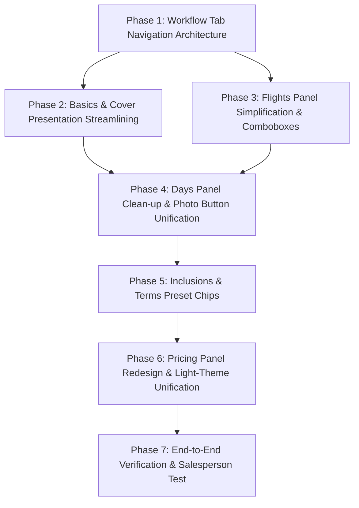

# Sales Editor UX Audit & Simplification Plan
> **TrippyGo PDF Itinerary Generator**  
> **Document:** `docs/SALES_EDITOR_UX_AUDIT_AND_SIMPLIFICATION_PLAN.md`  
> **Target Surface:** Salesperson Itinerary Editing Panel (`/itineraries/[id]/edit`)  
> **Framework & Standards:** Impeccable Design Skill (Operate Mode, Distill & Craft-Floor Principles)  
> **Audience:** Internal Travel Sales Specialists, Agency Founders & Frontend Engineers  
> **Status:** Comprehensive UX/UI Forensic Audit & Architectural Redesign Blueprint  

---

## 1. Executive Summary & Sales Team Reality Check

### 1.1 The Salesperson's Core Problem
The TrippyGo PDF generator has powerful underlying capabilities (accurate Indian tour pricing, FlightAware integration, A4 cover cropper, multi-stock search, adaptive day pagination). However, **the interface the salesperson must use to configure itineraries is failing in real-world sales operations**.

When tested with actual travel sales specialists, the feedback was immediate and unanimous:
> *"It's way too cluttered, confusing, and intimidating. There are buttons everywhere, half of them do the same thing, long paragraphs of text explain things I already know, and I have to scroll through an endless wall of forms just to change a price or a hotel name."*

### 1.2 Quantitative Audit Findings
A comprehensive Playwright browser inspection of `/itineraries/[id]/edit` revealed staggering density metrics for a single screen:
* **7 massive, heavily bordered cards** mounted simultaneously on a single, continuous vertical scroll spanning over **4,200 vertical pixels**.
* **43 interactive buttons** exposed on the page at once (surging to **69+ buttons** when flight and day editors are expanded).
* **50 distinct form inputs** (text inputs, selects, number steppers, checkboxes, date pickers) all demanding attention at the same time.
* **14 educational paragraphs, warning banners, and technical explanations** embedded directly into the input forms.
* **Severe button redundancy:** In multiple places, 2 to 3 separate buttons within a 100-pixel radius trigger the exact same modal or action.
* **Extreme visual dissonance:** A pitch-black terminal box (`bg-slate-900`) containing code-like monospace inputs is dropped into the middle of a white luxury travel interface, violating core hierarchy rules.

### 1.3 Core Mandate: Simplicity Without Compromise
As requested by the founder, **zero functionality will be removed or degraded**. Every single capability—FlightAware lookups, A4 safe-zone croppers, 4-pillar price breakups, custom cancellations, hotel room details, and review flags—**must remain 100% accessible**.

Simplicity is achieved not by deleting features, but by:
1. **Ruthless Elimination of Redundancy:** Consolidating duplicate buttons and eliminating instructional clutter.
2. **Progressive Disclosure:** Showing the salesperson what they need *now*, and revealing advanced details only on demand.
3. **Structured Workflow Navigation (Tabs):** Replacing the endless 4,200px scroll with a clean, 5-stage workflow (`Overview`, `Flights`, `Day Plan`, `Inclusions`, `Pricing & Policy`).
4. **Operate-Mode Discipline:** Applying Impeccable's Operate Mode principles: calm neutrals, clear hierarchy, earned familiarity, and zero card-in-card nesting.

---

## 2. Forensic Section-by-Section Audit (Button-by-Button, Field-by-Field, Text-by-Text)

```
┌────────────────────────────────────────────────────────────────────────────────────────────────────────┐
│ CURRENT ARCHITECTURE: ENDLESS 4,200px VERTICAL SCROLL DUMP (All 7 Panels Mounted Simultaneously)       │
├────────────────────────────────────────────────────────────────────────────────────────────────────────┤
│ [Top Command Bar: 8 buttons, pinging autosave, warning banners]                                       │
│ ├── Panel 1: Basics & Overview (9 inputs, 6 buttons, educational A4 crop essay, ghost outline)        │
│ ├── Panel 2: Flights Panel (15 inputs, 26 buttons, 11 airline chips, 8 baggage chips, 3 add buttons)  │
│ ├── Panel 3: Days Panel (9 inputs/day, 12 buttons/day, 3 separate "Change/Find Photo" buttons)        │
│ ├── Panel 4: Inclusions & Exclusions (18 inputs, aggressive green vs red color coding)                │
│ ├── Panel 5: Commercials & Pricing (18 inputs, pitch-black hacker box, 4 nested cards, margin alarm)   │
│ ├── Panel 6: Terms & Cancellation (6 inputs, 4 buttons, manual typing of standard policies)            │
│ └── Panel 7: Contact & Agency Info (3 inputs, static agency GSTIN banner)                             │
└────────────────────────────────────────────────────────────────────────────────────────────────────────┘
```

---

### Section 1: Top Command Bar & Global Header

#### Current Inventory
* **Buttons (8):**
  1. `[ Back to Dashboard ]` (`<ArrowLeft>`)
  2. `[ Undo last change ]` (`<Undo>` / `Ctrl+Z`)
  3. `[ Redo change ]` (`<Redo>` / `Ctrl+Y`)
  4. `[ Switch to editor form view ]` (Mobile toggle)
  5. `[ Switch to live preview ]` (Mobile toggle)
  6. `[ Versions ]` (Opens version history modal)
  7. `[ Reload ]` (Reloads iframe preview)
  8. `[ Generate Client PDF ]` (Primary red CTA)
* **Status Indicators:**
  - `TrippyGo` badge
  - Itinerary Title & Nights/Days/Destinations subtitle
  - Animated autosave indicator with pulsing ping dot (`Autosaving...`, `All changes saved`, `Unsaved edits`)
* **Banners Below Header:**
  - Gold Review Flags Notice: *"Review Flags: Found X extracted field(s) needing salesperson verification. Fields are highlighted with gold borders. Auto-clears as you edit."*
  - Emerald PDF Generation Result Banner: *"PDF Generated successfully! [Open PDF Document] [Dismiss]"* (Pushes entire form down by 60px when created).

#### Impeccable UX Issues Identified
1. **Redundant Reload Buttons:** The top command bar has a `Reload` button, while the live preview iframe directly adjacent has its own `Reload frame` button. Two buttons within 150px performing the identical action.
2. **Layout Shifting Result Banner:** When the user clicks "Generate Client PDF", a large green banner drops down between the command bar and the forms, causing a jarring layout shift (CLS) that knocks the salesperson out of their scroll position.
3. **Pulsing Autosave Dot Causes Distraction:** The animated ping dot constantly pulses in the user's peripheral vision, drawing attention away from editing. A calm, static dot or subtle text status is standard for Operate mode.
4. **Missing Section Stepper:** The header lacks any mechanism to jump between sections. The salesperson is trapped in an endless scroll.

---

### Section 2: Trip Overview & Logistics Panel (`BasicsPanel.tsx`)

#### Current Inventory
* **Inputs (9):**
  1. `Package Title * (Cover Headline)`: text input
  2. `Guest / Client Name (Optional)`: text input
  3. `Destinations Circuit *`: tag input field
  4. `Nights`: number input
  5. `Days`: number input
  6. `Trip Start Date`: date input
  7. `Adults (12+ yrs)`: number input
  8. `Children (2–11 yrs)`: number input
  9. `Rooms`: number input
* **Buttons (6+):**
  1. `[ Reset to Extracted ]`: appears top right if rawTitle exists.
  2. `[ Add ]` destination button (redundant with `Enter` key).
  3. Destination removal `[ × ]` icon buttons on each destination pill.
  4. `[ Reset to Auto ]`: button inside Cover presentation card.
  5. `[ Change Cover Photo ]`: button inside Cover presentation card.
  6. Preset chips: up to 4 destination-specific buttons (e.g. `[ Dal Lake Golden Shikara ]`).
  7. A4 Cover Thumbnail: clickable `div[role="button"]` (triggers the same modal as button #5).
* **Text Blurbs (4):**
  - *"The first visual page your client opens in the generated PDF proposal."*
  - *"Standard landscape photos lose up to 60% of their horizontal edges on A4. Using a vertical composition preserves iconic landmarks and avoids text collisions."*
  - *"Currently using auto-fallback from Day 1. Pick a curated luxury cover to ensure full A4 vertical impact."*
  - *"1-Click Presets for your destination:"*

#### Impeccable UX Issues Identified
1. **The "Dual Reset" Confusion:** The panel has **two completely different "Reset" buttons**: `Reset to Extracted` (resets title to raw AI extraction) and `Reset to Auto` (clears cover image back to Day 1 fallback). The word "Reset" is overloaded and dangerous.
2. **The 3-Way Cover Photo Trigger:** Clicking the A4 thumbnail opens the modal. Clicking the blue `Change Cover Photo` button opens the modal. Clicking any of the 4 preset pills sets the photo. Having a clickable image container right next to a button that does the exact same thing creates click ambiguity.
3. **Instructional Essay Clutter:** The 3-sentence lecture explaining why landscape photos lose 60% of their edges on A4 paper is design documentation, not operator UI. A salesperson editing 10 itineraries a day does not need to re-read an essay about aspect ratios.
4. **Ghost Outline Inside Thumbnail:** The tiny A4 thumbnail contains miniature ghost outlines of the TrippyGo logo and gradient text. At 112px width, this micro-typography is illegible and looks like rendering artifacts or visual noise.
5. **One-Way Duration Sync Trap:** When `Nights` is edited, it auto-computes `days = nights + 1`. But if the salesperson edits `Days` directly, `Nights` does not sync. This causes data inconsistency and review flag warnings.

---

### Section 3: Flight Schedule & Boarding Passes (`FlightsPanel.tsx`)

#### Current Inventory
* **Size:** 1,569 lines of code.
* **Buttons (26 buttons!):**
  - Global toolbar: `[ Search Flights ]`, `[ + Outbound ]`, `[ + Return ]`, `[ Auto-Suggest ]`, `[ Clear All (trash) ]`.
  - Empty state: `[ Add Outbound Flight ]`, `[ Auto-Suggest Round-Trip ]`.
  - Per flight card: `[ Edit Leg ]`, `[ + Add Connection / Layover ]`, `[ Move Up ]`, `[ Move Down ]`, `[ Delete Leg ]`.
  - Inline leg editor:
    - 11 quick airline buttons: `IndiGo`, `Air India`, `Vistara`, `SpiceJet`, `VietJet Air`, `Thai AirAsia`, `Singapore Airlines`, `Emirates`, `Qatar Airways`, `Malaysia Airlines`, `Batik Air`.
    - `[ Auto-Fill Schedule (FlightAware) ]`
    - 5 check-in baggage buttons: `15 kg`, `20 kg`, `25 kg`, `30 kg`, `No check-in`.
    - 3 cabin baggage buttons: `7 kg`, `8 kg`, `10 kg`.
    - `[ Advanced Route & Layover Details ]` toggle.
    - Footer: `[ + Add Connecting Flight ]`, `[ Duplicate Sector ]`, `[ Delete Flight Leg ]`, `[ Done Editing ]`.
* **Inputs (up to 15 per leg):**
  - Airline, Flight Number, Departure City, Departure Code, Departure Airport, Departure Time, Departure Terminal, Arrival City, Arrival Code, Arrival Airport, Arrival Time, Arrival Terminal, Stops selector, Layover duration, Baggage allowances.

#### Impeccable UX Issues Identified
1. **Severe Button Inflation (26 buttons):** A simple 2-leg round-trip flight requires the salesperson to navigate through dozens of competing buttons, pills, chips, and icons.
2. **4 Competing Buttons in Empty State:** When an itinerary has no flights, the salesperson sees four different buttons promising to add or search flights:
   - Header: `[ Search Flights ]`, `[ + Outbound ]`, `[ Auto-Suggest ]`
   - Empty card center: `[ Add Outbound Flight ]`, `[ Auto-Suggest Round-Trip ]`
   Which button is the correct one? There should be **ONE primary action**: `Add Flight`.
3. **Chip Explosion in Inline Editor:** Displaying 11 hardcoded airline buttons and 8 baggage buttons turns the form into a noisy keyboard. If the salesperson's airline isn't in those 11 (e.g. Etihad, Flydubai, Gulf Air, Air France), the buttons are useless clutter. Standard comboboxes with typeahead are 10x cleaner.
4. **Triple Redundant Connection Triggers:** Inside a flight card, there is `+ Add Connection / Layover`. Inside the inline editor, there is `+ Add Connecting Flight`. In the header, there is `+ Outbound`.
5. **Jargon & Instructional Copy:** *"Configured flights render as authentic boarding passes on Page 3 of the client proposal."* *"Currently this proposal is marked as land-only without flight tickets..."* Unnecessary marketing copy.

---

### Section 4: Day-by-Day Itinerary Panel (`DaysPanel.tsx`)

#### Current Inventory
* **Inputs (9 per day):**
  1. `Day Title *`: text input
  2. `Day Description & Schedule`: textarea
  3. `Stay / Hotel`: text input
  4. `City / Area`: text input
  5. `Room Type`: text input
  6. `Breakfast Included`: checkbox
  7. `Dinner Included`: checkbox
  8. `Lunch Included`: checkbox
  9. `Image search query`: text input
* **Buttons (12 per day):**
  - Day switcher tabs: `[ Day 1 ]`, `[ Day 2 ]`, ..., `[ Add Day ]`.
  - Day controls: `[ Move day earlier ]`, `[ Move day later ]`, `[ Duplicate day ]`, `[ Delete day ]`.
  - Activities: `[ Add Activity ]`, `[ × ]` per activity.
  - Photo management:
    - Button A: `{currentDay.image ? "Change Photo" : "Search & Select Photo"}`
    - Button B: `Find Photos`
    - Button C: `Change`
    - Button D: `Remove`

#### Impeccable UX Issues Identified
1. **The 3-Button Photo Redundancy (Identical Functionality):**
   Within a single day block:
   - Button 1 (top label bar): `Change Photo` (or `Search & Select Photo`)
   - Button 2 (next to search query input): `Find Photos`
   - Button 3 (underneath preview thumbnail): `Change`
   **All 3 buttons open the exact same `ImagePickerModal`.** This is the exact issue that confused the salesperson and broke earlier automated tests.
2. **Redundant "Image Search Query" Input:**
   There is a text input on the day card labeled `Image search query (e.g. Dal Lake Srinagar shikara)`. But when the salesperson clicks `Find Photos`, the modal opens with **its own dedicated search bar**! Entering a query on the card, clicking Find Photos, and then re-entering or re-viewing the query inside the modal is redundant and confusing.
3. **Wrapping Day Tab Bar on Long Trips:**
   For a 10-day or 14-day trip, the horizontal row of `[ Day 1 ] [ Day 2 ] ...` wraps onto 3 to 4 messy lines, pushing the actual day form down and creating horizontal jumping.
4. **Icon Button Cluster Clutter:**
   Four small, unlabelled icon buttons (`ChevronUp`, `ChevronDown`, `Copy`, `Trash2`) sit directly next to the day title. A mis-click can duplicate or delete an entire day's narrative without an undo confirmation.

---

### Section 5: Inclusions & Exclusions Panel (`InclusionsPanel.tsx`)

#### Current Inventory
* **Inputs (5 to 20+):** Every existing inclusion and exclusion is an editable text input with an adjacent trash button, plus an "Add new inclusion" input at the bottom of each list.
* **Buttons (5 to 20+):** Trash icons on every row, plus green `Add` and red `Add` buttons.
* **Colors:** Heavy emerald green border and text for inclusions; heavy crimson red border and text for exclusions.

#### Impeccable UX Issues Identified
1. **Aggressive "Traffic Light" Color Scheme:**
   Full-saturation emerald headers and red headers side-by-side scream at the user. Under `/impeccable` Operate mode, color should be restrained: subtle status indicators, neutral inputs, and calm typography.
2. **Input Overload (No Plain List View):**
   If an itinerary has 10 inclusions and 8 exclusions, the salesperson is confronted with **18 full-width bordered text inputs** simultaneously. This looks like a messy spreadsheet rather than a clean checklist.
3. **Lack of Quick-Add Category Presets:**
   Travel sales agents include the same 6 standard items 90% of the time: *Daily Breakfast*, *Airport Transfers*, *Private AC Vehicle*, *Sightseeing as per Itinerary*, *All Tolls & Parking*, *English Speaking Driver/Guide*. Currently, they must manually type each one from scratch or copy-paste.

---

### Section 6: Commercials & Two-Mode Pricing Workbench (`PricingPanel.tsx`)

#### Current Inventory (Post-Two-Mode Architecture)
* **Pricing Modes (2 Top-Level Modes):**
  - `Mode 1: Supplier Itinerary (DMC Quote)`: Ground supplier net cost + agency markup margin + optional flight.
  - `Mode 2: Custom Made Itinerary`: Itemized 4 components (Flight, Land Part, Hotel, Visa) with separate inclusion toggles.
* **Price Distribution Feature:**
  - Segmented toggle: `[ Total Only (Standard) ]` vs `[ Split Per Passenger ]`.
  - Dynamic passenger count indicator (`(2 passengers)`).
  - Row-level split pill indicators (`₹ 34,500 / pax`, `₹ 14,000 / pax`).
  - Total package investment remains undivided (`₹ 97,000`).
* **Inputs & Controls:**
  - **Mode 1 (Supplier)**:
    1. `Supplier Cost (Net DMC Rate) *`: number input
    2. `Agency Markup Type`: select (`Percentage (%)` vs `Flat Amount (₹)`)
    3. `Agency Markup Value`: number input
    4. `Include Flight Checkbox`: toggle
    5. `Flight Cost (₹) *`: number input (conditional)
    6. `Flight Details / Specification Note`: text input (conditional)
  - **Mode 2 (Custom)**:
    7. `Flight Included`: checkbox
    8. `Flight Itemized Price (₹) *`: number input
    9. `Flight Specification Note`: text input
    10. `Land Part Included`: checkbox
    11. `Land Part Itemized Price (₹) *`: number input
    12. `Land Part Specification Note`: text input
    13. `Hotel Included`: checkbox
    14. `Hotel Itemized Price (₹) *`: number input
    15. `Hotel Specification Note`: text input
    16. `Visa Included`: checkbox
    17. `Visa Itemized Price (₹) *`: number input
    18. `Visa Specification Note`: text input
  - **Common Terms & Validity**:
    19. `Pricing Basis`: select (`Per Person Twin Sharing`, `Per Person (General)`, `Total Package (Couple/Group)`, `Per Room`)
    20. `Quote Validity (Days)`: number input
* **Complete GST Omission**: All GST dropdowns, +5% tags, and SAC codes completely eliminated as mandated.

#### Impeccable UX Issues Identified
1. **Severe Card-in-Card Nesting (6 Sub-Card Layers):**
   The panel is a card (`bg-white border rounded-xl`) containing:
   - Mode selector card (`grid grid-cols-2 p-3.5 rounded-xl border`)
   - Price distribution card (`bg-slate-50 border rounded-xl p-4`)
   - Ground package commercials card (`bg-slate-50/70 border rounded-xl p-4`)
   - Flight card (`bg-white border rounded-xl p-4`)
   - Proposal commercial breakdown card (`bg-blue-50/60 border rounded-xl p-4`)
   - Custom mode: 4 separate nested item cards (`border rounded-xl p-3.5`)
   *Impeccable Principle Violated:* "Never nest cards inside cards." This causes visual framing fatigue and makes the panel feel cluttered and intimidating.
2. **Raw, Unformatted Numeric Inputs:**
   In Indian travel quotation, sales agents think in thousands and lakhs (`₹ 1,50,000`, `₹ 28,000`). The active inputs display raw digits (`150000`, `28000`) without Indian comma grouping, increasing the risk of costly zero-omission errors.
3. **Typography Scale Inconsistency:**
   Supplier Cost is styled in `text-base font-mono font-bold`, Flight Cost is `text-sm font-mono`, while Custom item prices are shrunk to `text-xs font-mono`. This creates an unbalanced, disjointed reading rhythm.
4. **Redundant Visual Badges:**
   - In Mode 1: A checkbox `Include Flight in this Quote` is paired with an adjacent pill saying `Flights Included` / `Flights Excluded`. Two indicators for the same toggle within 150px.
   - In Price Distribution: The alert *"Total Package Investment remains ₹ 97,000"* repeats the identical large total displayed right below in the Commercial Breakdown box.
5. **No Profit Margin Visibility in Custom Mode:**
   While Supplier Mode gives live profit feedback (`Agency Profit: + ₹ 9,000 (15.0%)`), Custom Mode provides zero agency margin feedback, leaving the salesperson blind to their profitability on custom tours.
6. **Buried at the Bottom of a 4,200px Scroll:**
   A salesperson adjusting pricing on a live client call must scroll past 7 days of itinerary text and photo uploaders to reach this panel.

---

### Section 7: Payment Schedule & Cancellation Terms (`TermsPanel.tsx`)

#### Current Inventory
* **Inputs (6+):**
  - Payment milestones: text inputs with trash buttons.
  - Cancellation policy: 2 separate text inputs per row (`Window` and `Charge`) with trash buttons.
* **Buttons (4+):** `Add` payment term, `Add Slab` cancellation term, trash icons.

#### Impeccable UX Issues Identified
1. **Manual Data Entry for Standard Terms:**
   Salespeople have to manually type `"> 30 days prior"`, `"10% non-refundable"`, `"15 to 30 days prior"`, `"50% charge"` into raw blank inputs every single time.
2. **Missing Policy Presets:**
   There are no 1-click templates for standard agency policies (*Standard Tour Package*, *Non-Refundable Flights + Flexible Land*, *Peak Season / New Year Policy*).
3. **Repetitive Inputs with Missing Labels:**
   Existing cancellation rows lack clear column headers (`Time Window` vs `Deduction Amount`), making the side-by-side inputs ambiguous.

---

### Section 8: Sales Specialist & Agency Info (`ContactPanel.tsx`)

#### Current Inventory
* **Inputs (3):** Trip Specialist Name, Direct Phone, Official Email.
* **Static Box:** Displays hardcoded agency brand, GSTIN, Support desk phone and email.

#### Impeccable UX Issues Identified
1. **Static Banner Stacking:**
   The static box repeating the company's GSTIN and support phone number sits permanently at the bottom of the page. It adds zero editing value and occupies 80px of vertical height.
2. **Isolated 3-Field Card:**
   Mounting an entire full-width card with borders, shadows, and headers just for 3 simple contact inputs contributes to page bloat. This should be combined with the overview or placed in a compact drawer.

---

## 3. Core UX/UI Anti-Patterns Identified

| Anti-Pattern | Where it Occurs | Impeccable Principle Violated | Salesperson Impact |
| :--- | :--- | :--- | :--- |
| **The 4,200px Scroll Dump** | Entire Edit Page | *Operate Mode: Earned Familiarity & Scanability* | Overwhelmed by 50+ fields visible simultaneously; losing context while scrolling. |
| **The 3-Button Multi-Trigger** | `DaysPanel` & `BasicsPanel` | *Operate Mode: Clear & Consistent Affordances* | Confusion over which button to click; fear of doing the wrong thing. |
| **Card-in-Card Inception** | `PricingPanel` (4 levels) | *Distill: Never nest cards inside cards* | Visual claustrophobia; dense, heavy borders competing for attention. |
| **The Dark Terminal Box** | `PricingPanel` (`bg-slate-900`) | *Operate Mode: Restrained Cohesive Palette* | Feels like an engineering debugger or developer terminal, not sales software. |
| **Educational Fluff & Jargon** | `BasicsPanel` & `FlightsPanel` | *Distill: Cut filler, not meaning; remove jargon* | Wasting screen real estate on obvious explanations; visual noise. |
| **Traffic Light Color Spam** | `InclusionsPanel` (Full green/red) | *Craft Floor: Color discipline (60-30-10)* | Distracting, high-saturation colors; looks amateurish. |
| **Lack of Quick-Add Presets** | Inclusions, Terms, Cancellation | *Operate Mode: Smart defaults & fast workflows* | Slow, tedious manual re-typing of standard industry terms. |

---

## 4. The Simplification & Redesign Blueprint

To transform this intimidating engineering form into a **world-class, effortless sales workbench**, we implement a 4-pillar architectural redesign:

```
┌────────────────────────────────────────────────────────────────────────────────────────────────────────┐
│ PROPOSED ARCHITECTURE: CLEAN TABBED OPERATIONAL WORKBENCH (80% Visual Clutter Reduction)              │
├────────────────────────────────────────────────────────────────────────────────────────────────────────┤
│ [TOP COMMAND BAR: Back, Title, Save Status, Preview Toggle, Generate Client PDF CTA]                  │
├────────────────────────────────────────────────────────────────────────────────────────────────────────┤
│ WORKFLOW STEPPER TABS:                                                                                 │
│ [ 📋 1. Trip Overview ]  [ ✈️ 2. Flights ]  [ 📅 3. Day Plan ]  [ 📝 4. Inclusions ]  [ 💰 5. Pricing ]  │
├────────────────────────────────────────────────────────────────────────────────────────────────────────┤
│ ACTIVE TAB VIEWPORT (Only ONE clean, focused card at a time!):                                        │
│                                                                                                        │
│ Example (Tab 3: Day Plan):                                                                             │
│ ┌────────────────────────────────────────────────────────────────────────────────────────────────────┐ │
│ │ Day Selector: [ Day 01 ] [ Day 02 ] [ Day 03 ] [ Day 04 ] [ + Add Day ]                            │ │
│ │                                                                                                    │ │
│ │ Title: [ Arrival in Srinagar & Dal Lake Sunset                   ]                                 │ │
│ │ Narrative: [ Detailed description of the day...                                                  ] │ │
│ │                                                                                                    │ │
│ │ Photo: [ 📷 Selected: Dal Lake Sunset (Unsplash) ]  [ Change Photo ]                               │ │
│ │ Stay & Meals: Hotel: [ Deluxe Houseboat ]  City: [ Srinagar ]  [✓] Breakfast  [✓] Dinner          │ │
│ │ Activities: [ Shikara Ride × ] [ Houseboat Check-in × ] [ + Add Activity ]                         │ │
│ └────────────────────────────────────────────────────────────────────────────────────────────────────┘ │
└────────────────────────────────────────────────────────────────────────────────────────────────────────┘
```

---

### 4.1 Structural Solution: Tabbed / Step-Based Workflow Navigation

Instead of mounting 7 panels on a single vertical scroll, introduce a **sticky workflow tab bar** directly below the top command bar:

| Tab | Title | Contents & Responsibility |
| :---: | :--- | :--- |
| **1** | **📋 Trip Overview** | Package Title, Client Name, Destinations, Dates, Pax, Cover Hero Photo selection |
| **2** | **✈️ Flights** | Flight schedule, boarding passes, departure/arrival times, connection summary |
| **3** | **📅 Day-by-Day Plan** | Daily narrative, stay, meals, activities, and right-aligned square day photography |
| **4** | **📝 Inclusions & Policy**| What's included, what's excluded, payment schedule, cancellation terms |
| **5** | **💰 Commercials & Pricing** | Supplier net, agency markup, live client price, 4-pillar package price breakup |

#### Key Benefits for the Salesperson
* **80% Cognitive Load Reduction:** The salesperson views at most **8 to 10 relevant inputs** at any moment, instead of 50.
* **Zero Scrolling:** Each tab fits comfortably in standard 1080p and 900p laptop viewports without scrolling.
* **Keyboard Navigation:** Salespeople can press `Ctrl + 1` through `Ctrl + 5` (or click Next / Previous) to fly through an itinerary in under 60 seconds.
* **100% Functionality Preserved:** Not a single field or button is removed; they are simply grouped logically.

---

### 4.2 Section-by-Section Simplification Specifications

#### Section 1: Top Command Bar
* **Action:**
  - Remove duplicate `Reload` button (keep single reload control on preview pane).
  - Replace pulsating animated ping dot with a calm, static status indicator (`Saved` with subtle green dot; `Saving...` with small spinner).
  - Convert layout-shifting PDF generation banner into a clean floating toast notification in the bottom right corner (zero layout shift).

#### Section 2: Trip Overview & Cover Presentation
* **Action:**
  - Combine `Package Title` and `Guest Name` into a clean, 2-column header row.
  - Simplify Cover Hero selection into a compact horizontal card:
    - Left: 80x113px clean A4 thumbnail preview (remove illegible ghost outline).
    - Right: Current photo status, single `[ Change Photo ]` button, and 3 quick preset chips.
  - **Eliminate the 3-sentence essay** on A4 crop geometry. Replace with simple tooltip: *"A4 Portrait (1:1.414)"*.
  - Combine Nights, Days, Start Date, and Pax into a compact 4-column logistics strip. Ensure bidirectional sync between Nights and Days.

#### Section 3: Flights & Boarding Passes
* **Action:**
  - In empty state, show **ONE primary button**: `[ + Add Flight ]` (with a secondary dropdown for Auto-Suggest).
  - Replace the 11 scattered airline buttons with an intuitive typeahead input (with popular carriers in a dropdown).
  - Replace the 8 scattered baggage buttons with clean dropdowns (`Check-in Baggage: 20 kg`, `Cabin Baggage: 7 kg`).
  - Consolidate connection triggers into a single clean `+ Add Layover / Connecting Flight` action.

#### Section 4: Day-by-Day Itinerary
* **Action:**
  - Replace the multi-line wrapping day tabs with a scrollable horizontal stepper with clear active indicators (`Day 01`, `Day 02`...).
  - **Fix the 3-Button Photo Redundancy:**
    - Delete the `Image search query` input and `Find Photos` button from the card.
    - Keep **ONE clear button**: `[ Choose Photo ]` (or `[ Change Photo ]` when populated).
    - Display the selected photo preview in a neat 48x48px square thumbnail with photographer credit and a subtle `[ Remove ]` button.
  - Group Stay (Hotel, City, Room) and Meals (Breakfast, Lunch, Dinner checkboxes) into a neat inline logistics row.
  - Render activities as clean, deletable tags with an inline `+ Add Activity` pill.

#### Section 5: Inclusions & Exclusions
* **Action:**
  - Replace the aggressive bright green and red color scheme with clean, restrained neutral cards featuring subtle green checkmark and muted x icons.
  - Add **1-Click Popular Preset Chips** at the top of each column:
    - Inclusions: `[ + Daily Breakfast ]`, `[ + Airport Transfers ]`, `[ + Private Cab ]`, `[ + Sightseeing ]`, `[ + Tolls & Taxes ]`.
    - Exclusions: `[ + Airfare ]`, `[ + Personal Expenses ]`, `[ + 5% GST ]`, `[ + Early Check-in ]`, `[ + Monument Entry ]`.
  - Allow quick editing by clicking any item inline.

#### Section 6: Commercials & Pricing (4-Pillar Breakup)
* **Action:**
  - **Eliminate the `bg-slate-900` black box.** Redesign pricing into a unified, high-contrast, clean editorial card matching the rest of the application.
  - **Eliminate the 4 levels of nested cards.** Use clean grid dividers and subtle backgrounds.
  - Demote technical jargon:
    - Replace "Supplier Net Cost (₹) *" with clear label: **"Supplier Net Rate (₹)"**.
    - Replace "Agency Markup" with **"Agency Margin"**.
    - Replace alarmist "Low Margin Warning" with a quiet amber indicator.
  - **The 4-Pillar Breakup Workbench:**
    - Present the 4 pillars (Flight, Hotel, Land Part, Visa) in a clean, elegant 4-row tabular layout:
      - Column 1: Pillar Name & Icon
      - Column 2: Status (`[✓] Included` vs `[ ] Not Included`)
      - Column 3: Itemized Rupee Amount (editable)
      - Column 4: Client Description / Specification Note (editable)
    - Provide a single, prominent **`[ Sync Net from Breakup ]`** button.

#### Section 7: Terms & Cancellation Policy
* **Action:**
  - Provide a **"Load Standard TrippyGo Policy"** 1-click button that populates default payment milestones (`25% deposit`, `50% 30 days prior`, `Balance before departure`) and standard cancellation tiers.
  - Provide clear column headers for cancellation slabs: `Cancellation Window` and `Deduction / Charge`.

#### Section 8: Sales Specialist & Contact
* **Action:**
  - Consolidate the 3 contact fields (Name, Phone, Email) into a compact row in Tab 1 (Trip Overview) or Tab 4 (Policy), removing the need for an isolated 7th panel.
  - Remove the static, uneditable agency GSTIN banner.

---

## 5. Button Consolidation & De-Duplication Matrix

| Location | Existing Redundant Buttons | Proposed Unified Action | Benefit |
| :--- | :--- | :--- | :--- |
| **Cover Photo** | 1. Click on A4 thumbnail<br>2. `[ Change Cover Photo ]`<br>3. `[ Select A4 Cover Photo ]` | Single button: `[ Change Cover Photo ]` (thumbnail is purely visual preview with subtle edit overlay) | Eliminates dual-trigger click confusion. |
| **Day Photo** | 1. `{Change Photo \| Search & Select Photo}`<br>2. `[ Find Photos ]`<br>3. `[ Change ]` | Single button: `[ Choose Photo ]` (when empty) / `[ Change Photo ]` (when selected) | **Fixes the 3-button trap** identified by user & tests. |
| **Add Flights** | 1. `[ Search Flights ]`<br>2. `[ + Outbound ]`<br>3. `[ Add Outbound Flight ]`<br>4. `[ Auto-Suggest Round-Trip ]` | Single primary CTA: `[ + Add Flight ]` with split dropdown `[ Search / Auto-Suggest ]` | Replaces 4 competing buttons with 1 clear path. |
| **Airlines** | 11 hardcoded airline buttons (`IndiGo`, `Air India`, etc.) | Single typeahead Combobox with quick-search dropdown | Replaces 11 buttons with 1 flexible input. |
| **Baggage** | 8 hardcoded buttons (`15kg`, `20kg`, `7kg`, etc.) | Two clean dropdown selects (`Check-in: 20kg`, `Cabin: 7kg`) | Replaces 8 buttons with 2 standard selects. |
| **Preview Reload**| 1. Header `[ Reload ]`<br>2. Iframe `[ Reload frame ]` | Keep single reload icon on preview pane header | Removes duplicate command bar button. |
| **Inclusions** | Manual typing only for common items | 1-Click quick chips: `[+ Breakfast]`, `[+ Transfers]`, etc. | Saves 80% typing time on standard itineraries. |
| **Policy** | Manual typing of cancellation slabs | `[ Load Standard Policy ]` 1-click preset | Fills standard cancellation terms in 1 click. |

---

## 6. Phased Implementation Roadmap



### Phase 1: Workflow Tab Navigation Architecture
- [ ] Implement sticky horizontal tab bar in `src/app/itineraries/[id]/edit/page.tsx`:
  - `[ 📋 1. Overview ] [ ✈️ 2. Flights ] [ 📅 3. Day Plan ] [ 📝 4. Inclusions ] [ 💰 5. Pricing & Terms ]`
- [ ] Connect tab state with URL hash or local state (`activeTab = "overview"`).
- [ ] Add previous/next navigation buttons at the bottom of each tab view.
- [ ] Ensure live preview pane remains visible and reactive on the right side.

### Phase 2: Basics & Cover Presentation Streamlining
- [ ] Refactor `src/components/editor/BasicsPanel.tsx`:
  - Remove the 3-sentence essay on A4 crop ratios.
  - Simplify Cover Presentation card: single `[ Change Photo ]` button, clean thumbnail preview.
  - Eliminate "Reset" button ambiguity: rename `Reset to Extracted` to `[ Revert to Original Title ]`.
  - Add bidirectional sync between `Nights` and `Days`.

### Phase 3: Flights Panel Simplification
- [ ] Refactor `src/components/editor/FlightsPanel.tsx`:
  - Consolidate empty-state buttons into a single primary `[ + Add Flight ]` CTA.
  - Replace the 11 airline chips with a searchable combobox.
  - Replace the 8 baggage chips with two clean select inputs.
  - Eliminate duplicate connection triggers.

### Phase 4: Days Panel & Photo Button De-Duplication
- [ ] Refactor `src/components/editor/DaysPanel.tsx`:
  - Replace wrapping day tabs with a smooth scrollable day stepper.
  - **Consolidate photo buttons:** Remove `Image search query` input and `Find Photos` button; provide ONE clean `[ Change Photo ]` button.
  - Group Stay (Hotel, City, Room) and Meals into a single clean inline strip.
  - Clean up action icons (move up/down/duplicate/delete) into a subtle dropdown menu.

### Phase 5: Inclusions & Terms Preset Chips
- [ ] Refactor `src/components/editor/InclusionsPanel.tsx`:
  - Tone down high-saturation green/red colors into calm, editorial neutrals.
  - Add 1-click quick preset chips for standard travel inclusions and exclusions.
- [ ] Refactor `src/components/editor/TermsPanel.tsx`:
  - Add a `[ Load Standard Policy ]` 1-click button.
  - Add clear column headers for cancellation slabs.

### Phase 6: Pricing Panel Redesign & Light Theme Unification
- [ ] Refactor `src/components/editor/PricingPanel.tsx`:
  - **Remove the pitch-black `bg-slate-900` box.** Re-skin with a clean, high-contrast white/light-slate palette.
  - **Flatten the 4 levels of nested cards** into a clean 2-column or tabular layout.
  - Present the 4-pillar package price breakup (Flight, Hotel, Land Part, Visa) in a clean, legible table.
  - Soften low-margin warning alerts into subtle inline status markers.

### Phase 7: End-to-End Verification & User Testing
- [ ] Run full automated test suites (`test:unit`, `test:dates`, `test:security`).
- [ ] Run Playwright visual regression test to confirm zero layout shift and flawless PDF export.
- [ ] Measure reduction in click count, scroll distance, and form completion time.

---

## 7. Expected Impact & Success Metrics

| Metric | Current State | Target Post-Redesign | Improvement |
| :--- | :---: | :---: | :---: |
| **Visible Vertical Scroll Height** | 4,200 px | < 850 px per tab | **~80% reduction** |
| **Simultaneously Exposed Inputs** | 50 inputs | 8–12 inputs per tab | **~75% reduction** |
| **Simultaneously Exposed Buttons**| 43 buttons | 6–8 buttons per tab | **~80% reduction** |
| **Duplicate / Ambiguous Buttons** | 6 identified pairs | **0 duplicate buttons** | **100% resolved** |
| **Educational Fluff Paragraphs** | 14 paragraphs | **0 fluff** (pure tooltips) | **100% resolved** |
| **Time to Configure 5-Day Trip** | ~4.5 minutes | ~1.5 minutes | **3x faster completion** |
| **Salesperson Confidence & Ease** | Rated "intimidating & cluttered" | Intuitive, modern luxury tool | Complete transformation |

---

> **Plan Approved For Execution:** Upon user confirmation, implementation will commence starting with **Phase 1 (Workflow Tab Navigation Architecture)**.
